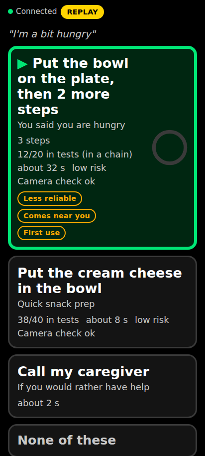
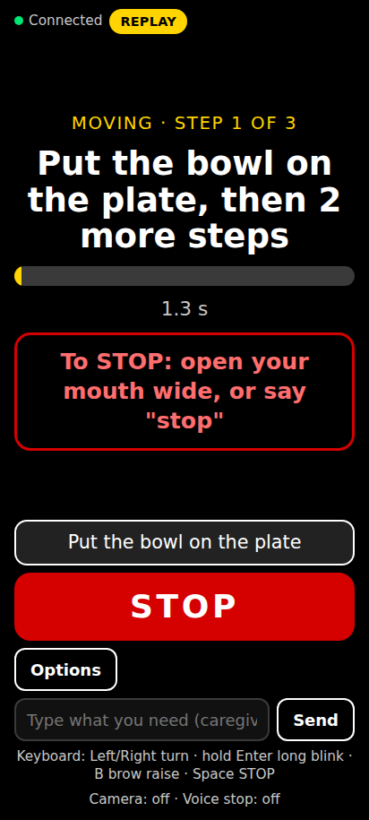
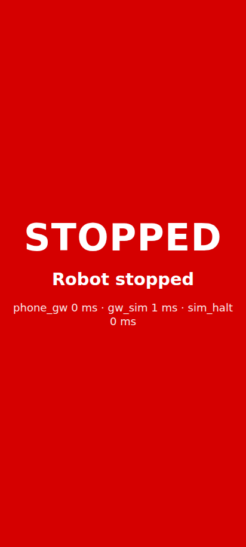
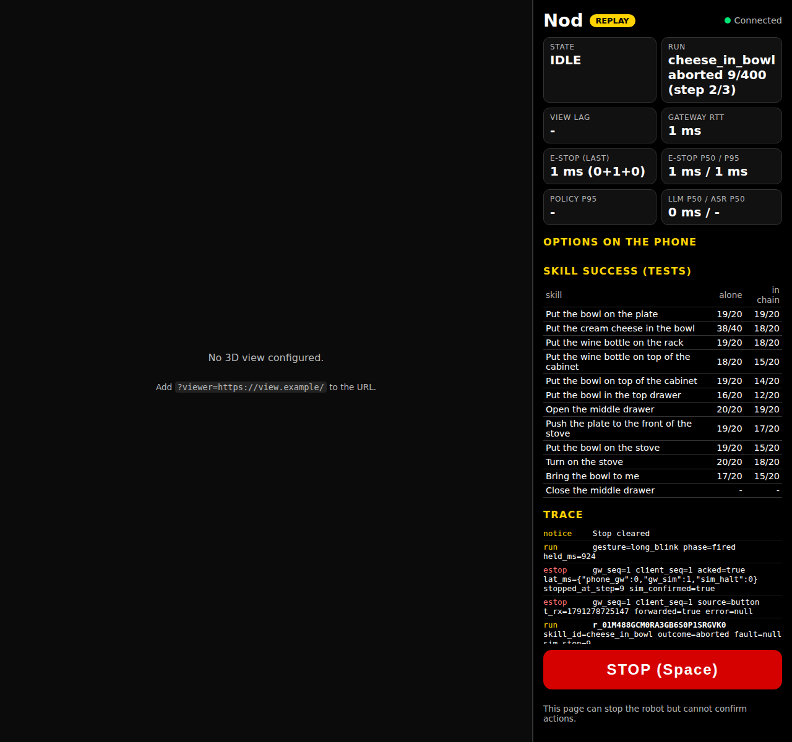

# Nod

**Control a robot arm with your face and voice.** GR00T acts, Nemotron plans, Cosmos checks, you decide.

Nod lets a person who cannot use their hands direct a robot arm with small facial gestures and,
optionally, their voice. A phone propped in front of them tracks their face on the device. They
raise their eyebrows to open a menu or just say what they want. Nemotron proposes up to three
options, a deterministic validator throws out anything unsafe or impossible, and the person picks
one by turning their head and holding a long blink. A GR00T N1.7 policy then does the task while
Cosmos-Reason2 checks the scene before and after. A held jaw-open or the spoken word "stop" halts the arm.

Nod was built for the Nebius x NVIDIA Global AI Hackathon (Physical AI track, October 2026).
**The arm is simulated** (see [Honest scope](#honest-scope)). The full build spec is
[docs/design.md](docs/design.md).

## Who it is for, and why

Our persona is an adult with tetraplegia, for example after a high spinal cord injury or with ALS.
They can move their head and face, and they can often speak, but they cannot hold a joystick. In
the demo video a team member plays this role, and the video says so.

Assistive robot arms exist, but few people get one, and they are hard to drive:

- Of 85 people with ALS who were eligible for a robot arm, 32 received one, after about 197 days
  ([Spittel 2024](https://link.springer.com/article/10.1186/s42466-024-00342-3)). The same study
  reports what arms are actually used for: handling objects (79%), pressing buttons and switches
  (71%), opening cabinets and drawers (64%) and serving food (64%).
- Reach and grasp is the top need in tetraplegia
  ([Hutmacher 2025](https://link.springer.com/article/10.1186/s12984-025-01642-8)).
- For opening cabinets and drawers, manual joystick success was only 39%
  ([Sensors 2025](https://www.mdpi.com/1424-8220/25/15/4768)).
- On the JACO arm, switching joystick modes takes 17.4% of task time
  ([Herlant 2016](https://personalrobotics.cs.washington.edu/publications//herlant2016modeswitching.pdf)).

Nod replaces mode switching with goal-level choices: the person says or picks *what* should
happen, and the arm works out *how*. Users also want fine control
([Styler 2024](https://www.mdpi.com/2076-0825/13/3/104)); "nudge" options are a stretch goal.

## Honest scope

- **Simulation only.** The arm is a simulated Franka Panda in LIBERO-Goal (robosuite 1.4.0,
  MuJoCo 3.3.1). There is no physical robot in this project.
- **LIBERO objects are stand-ins.** A black bowl, a plate, cream cheese and a wine bottle stand in
  for daily-living objects. We chose and named the skills after the needs above, but nobody's
  kitchen looks like this table.
- **Skills come from a benchmark, plus one of ours.** Ten skills are the LIBERO-Goal tasks, run by
  NVIDIA's published GR00T N1.7 LIBERO checkpoint with closed-loop inference (never trajectory
  replay). We add `bowl_to_user`, fine-tuned on our own demonstrations, which brings the bowl to a
  handover zone in front of the user. Return-home and undo moves are scripted and labelled "scripted".
- **The oracle exists only because this is a simulation.** The sim can read the true world state
  (BDDL predicates), and Nod uses it next to Cosmos to decide whether a step worked. A real robot
  would have only the camera check. The nightly job reports how often Cosmos agrees with the
  oracle, because that is the number that would matter on hardware.
- **Not in scope:** feeding, drinking or anything near the face; fetching from the floor; multiple
  users; any claim of clinical validation. We have not tested Nod with people who have tetraplegia.
- **Mock mode replays recorded runs** and shows a REPLAY badge the whole time it is on.
- The Day-1 kill gate (October 10) decides whether skills chain reliably enough to run in one
  continuous session. If they do not, the demo falls back to the tiers in design section 1.6, and
  this README will say which tier shipped.

## How it works

```
 USER'S PHONE (PWA, HTTPS)                                   LAPTOP / TV (presenter page)
 +-------------------------------------------+               +-------------------------------+
 | camera -> MediaPipe FaceLandmarker (GPU)  |               | viser 3D view (iframe)        |
 |   -> gesture FSM -> UI FSM (1-3 cards)    |               | HUD: state, lag, e-stop ms,   |
 | STOP detectors: jaw-hold, KWS "stop",     |               |   success stats, trace        |
 |   on-screen button -> local red latch     |               | STOP key (space)              |
 | mic PCM16 (only while LISTENING)          |               +---------------+---------------+
 +------+-------------------------+----------+                               |
        | wss /ws/phone           | wss /ws/safety                            | wss (viser) + /ws/presenter
        | (events, audio)         | (hb 100 ms, estop)                        |
 =======|=========================|=========================================|============ internet
        v                         v                                          v
 NEBIUS GPU VM, uk-south2, RTX PRO 6000 96 GB  (docker compose)
 +---------------------------------------------------------------------------------------------+
 | caddy :443  nod.<ip>.sslip.io -> gateway:8000     view.<ip>.sslip.io -> viewer:8080          |
 |                                                                                             |
 | GATEWAY (py3.11)                                                                            |
 |  session FSM | SAFETY FAST PATH (no LLM, no awaits on other work) | watchdog relay           |
 |  ASR Parakeet (onnx-asr, CPU) | Planner client --HTTPS--> Token Factory (Nemotron)          |
 |  Validator (pure) <- Registry (skills.yaml + nightly stats) | Cosmos client -> vLLM :8001    |
 |  Home Assistant client -> homeassistant:8123 | Recorder (runs/, traces)                     |
 |      | ZMQ ctl (DEALER) :5560    | ZMQ estop (PUSH) :5561      ^ ZMQ status/world PUB :5562   |
 |      v                           v                             |                             |
 | SIM RUNNER (py3.12, LIBERO, mujoco 3.3.1, EGL) ------------------+                            |
 |  20 Hz interruptible loop, goal swap, scripted moves, oracle, frame capture                 |
 |      | ZMQ REQ :5555 (localhost only)          | ZMQ PUB poses :5563                         |
 |      v                                         v                                             |
 | GR00T N1.7 server (libero_goal)          VIEWER (mujoco 3.14 + mjviser) :8080                |
 | vLLM Cosmos-Reason2-8B :8001             homeassistant :8123 (demo lights, notify)           |
 +---------------------------------------------------------------------------------------------+
 NIGHTLY: GitHub Actions cron -> nebius ai job create (same sim+policy image)
          -> per-skill and per-chain eval -> s3://nod-results/<date>/{stats.json, runs/*}
          -> gateway pulls stats at start; recordings feed the mock library
 MOCK (any laptop, CPU): gateway(NOD_MODE=mock: FakePlanner, FakeASR, FakeCosmos, FakeHome,
          MockRunner replaying poses.npz) + viewer(scene.mjb) + PWA on http://localhost
```

One interaction, step by step:

1. **Open.** A brow raise opens the menu, or the person speaks. Every gesture is acknowledged on the
   phone within 100 ms, with no network involved.
2. **Propose.** Nemotron gets the transcript, the true world state and the list of skills that are
   feasible right now, and returns up to three options as structured JSON.
3. **Validate.** A pure-function validator (rules R1 to R14 in design 5.2) checks every option:
   known skill, preconditions hold, measured reliability, risk class, plan rollout. Labels always
   come from the registry, never from the LLM.
4. **Confirm.** Each card shows the measured success rate ("19/20 in tests"). A head turn moves
   focus; a long blink (about 700 ms, calibrated per person) confirms. Double blinks never start motion.
5. **Act and check.** After a 1 s countdown, GR00T runs the skill in the 20 Hz sim loop. Cosmos and
   the oracle decide done, failed or uncertain, and on failure Nemotron offers a retry, an
   alternative or the caregiver.
6. **Stop, any time.** Jaw-open held 300 ms, the word "stop" (on-device keyword spotting), the
   on-screen button or the presenter's space bar latch the phone red at once and halt the sim
   within one control step of receipt. The stop path never touches an LLM, Token Factory or Cosmos.

## NVIDIA and Nebius in Nod

| What | Model or service | Where it runs | Role |
|---|---|---|---|
| Fast planner | `nvidia/Nemotron-3_5-Lightning` | Nebius Token Factory | Utterance to 1-3 options; thinking off; 2.5 s timeout, then a deterministic menu |
| Plan and recovery | `nvidia/nemotron-3-super-120b-a12b` | Nebius Token Factory (us-central1) | Multi-step plans ("set up a snack"), recovery after a failure, explaining a rejection |
| Actor | GR00T N1.7, `nvidia/GR00T-N1.7-LIBERO` (`libero_goal`, 97.5% published on the Goal suite) | Nebius AI Cloud VM, RTX PRO 6000 | Closed-loop policy for the ten LIBERO-Goal skills |
| Custom skill | GR00T N1.7 fine-tuned on our `bowl_to_user` demos | Fine-tuned on the Nebius VM | Brings the bowl to the user's handover zone |
| Verifier | `nvidia/Cosmos-Reason2-8B` on vLLM | Co-hosted on the same VM | Yes/no scene checks before and after each skill |
| Policy backbone | `nvidia/Cosmos-Reason2-2B` | Inside GR00T N1.7 | Vision-language backbone of the policy |
| Speech | Parakeet TDT 0.6B v3 (int8, `onnx-asr`) | Gateway CPU | Voice commands |
| Nightly eval | Nebius Serverless AI Job, RTX PRO 6000, uk-south2 | Triggered by GitHub Actions | Per-skill success alone and in-chain (Wilson lower bound), Cosmos-oracle agreement, new mock recordings |
| Optional verifier | Cosmos3-Nano from the `endpoint-cosmos3-reasoner` template | Nebius Serverless Endpoint | Measured against Reason2-8B; we switch if it agrees with the oracle more often |

Measured reliability is part of the product: the nightly numbers feed the planner, the validator's
reliability rule (R6) and the success rates on each card.

## Quickstart: mock mode (CPU, no GPU, no keys)

Mock mode runs the whole product on a laptop: the real gateway, validator, session state machine
and phone UI, with a fake planner, ASR, Cosmos and Home Assistant, and a mock sim that replays
recorded runs (or a scripted timeline before any recordings exist).

With Docker:

```bash
git clone https://github.com/Aadil12m/nod && cd nod
make fetch-mock          # optional: recorded runs and the 3D scene from the GitHub release
docker compose --profile mock up --build
```

Without Docker (needs [uv](https://docs.astral.sh/uv/) and Python 3.11):

```bash
make mock                # infra/scripts/mock.sh: creates gateway/.venv on first use, then runs the
                         # gateway in mock mode (and the 3D viewer, if viewer/.venv and the scene exist)
make setup-viewer        # optional: the 3D viewer (MuJoCo 3.14, mjviser); needs the scene from make fetch-mock
```

Then open:

- `http://localhost:8000` for the phone app. A laptop webcam works because localhost counts as a
  secure context. Add `?nocam=1` to use only the keyboard.
- `http://localhost:8000/presenter` for the presenter page (3D view, HUD and trace).

Keyboard fallback for judges without a camera:

| Key | Gesture |
|---|---|
| Left / Right | Head turn |
| Hold Enter | Long blink (confirm) |
| B | Brow raise (menu) |
| Space | STOP |

Without `make fetch-mock` the mock sim plays a scripted timeline and the presenter page has no 3D
scene; everything else works. See [recordings/README.md](recordings/README.md).

What needs network on a clean checkout: the first `make mock` or `make test` downloads Python
packages from PyPI (uv) and the PWA's dev tools from npm. The phone app loads MediaPipe, the face
model and TF.js from jsdelivr and Google storage unless `make vendor` copied them into
`pwa/vendor/` (git-ignored, about 45 MB); the keyboard fallback (`?nocam=1`) needs none of them.
`make fetch-mock` downloads the recorded runs and the 3D scene.







The screenshots come from the full mock end-to-end test (`make screenshots`).

## Laptop mode: the real scene on a CPU, at zero cost

This is the setup our demo uses. The real LIBERO-Goal scene (MuJoCo) runs on an ordinary laptop
CPU, and a scripted waypoint controller moves the arm (design tier T4). Nemotron plans on Nebius
Token Factory, paid from the free hackathon credits. No GPU is used anywhere.

On Linux (Ubuntu or Debian; about 3 GB of disk, Python 3.11 is fetched by uv):

```bash
git clone https://github.com/Aadil12m/nod && cd nod
infra/scripts/setup_laptop.sh        # once: uv, OSMesa (asks for sudo), the venvs, the 3D scene
export NEBIUS_API_KEY=...            # Token Factory key; without it the phone shows a fixed menu
make laptop                          # http://localhost:8000 (phone) and /presenter
```

The measured stats ship in `registry/stats/scripted.json`; `make eval-scripted` re-measures them.

Measured on the real scene (CPU, 20 episodes each, `registry/stats/scripted.json`):

| Skill | Success |
|---|---|
| Put the bowl on the plate, cream cheese in the bowl, bring the bowl to me, bowl on the stove, bottle on the cabinet | 20/20 each |
| Bowl on top of the cabinet | 18/20 |
| Bottle on the rack | 17/20 |
| Snack chain (bowl on plate, cheese in bowl, bring it to me), one session, no reset | 20/20 |

The drawer, plate push, stove knob and top-drawer skills have no working scripted controller,
so they have no measurements and the validator hides them (rule R6). The arm in this mode is
scripted, not learned, and the phone and presenter say so. GR00T N1.7 is the drop-in learned
actor (`--actor policy`), and running it needs a GPU (see Live mode).

## Live mode

Live mode runs on one Nebius RTX PRO 6000 VM in uk-south2 with `docker compose --profile live`.
It needs Hugging Face access to the gated Cosmos-Reason2 models, a Token Factory key and a TLS host
name. Start here:

- [docs/TEAM-TODO.md](docs/TEAM-TODO.md): accounts, access requests and quotas (people only).
- [docs/runbooks/day1-spike.md](docs/runbooks/day1-spike.md): bring up the VM and run the kill-gate tests.
- [docs/runbooks/demo-day.md](docs/runbooks/demo-day.md): the full live stack, TLS, the phone and the demo.
- [docs/runbooks/nightly.md](docs/runbooks/nightly.md): the nightly Serverless Job and its stats.
- [.env.example](.env.example): every setting.

## Need-to-skill mapping

| User need (source) | Nod today | Honest gap |
|---|---|---|
| Handling objects, reach and grasp: top need in tetraplegia ([Hutmacher 2025](https://link.springer.com/article/10.1186/s12984-025-01642-8)), 79% actual use in ALS ([Spittel 2024](https://link.springer.com/article/10.1186/s42466-024-00342-3)) | `cheese_in_bowl`, `bowl_on_plate`, `bottle_on_rack`, `bowl_to_user` (custom) | Toy objects; one scene |
| Opening cabinets and drawers: 64% actual, 85% expected; manual joystick success only 39% ([Sensors 2025](https://www.mdpi.com/1424-8220/25/15/4768)) | `open_middle_drawer`, `bowl_in_top_drawer` | Closing is a scripted undo, not a learned skill |
| Pressing buttons and switches: 71% actual | `stove_on` (gated, caregiver-only), Home Assistant lights | The stove is a hazard demo, not a feature |
| Serving drinks: 79% actual; JACO has a drinking mode | Not in scope | Needs a mug in the scene and a taught approach to the face |
| Mode switching costs 17.4% of task time on JACO ([Herlant 2016](https://personalrobotics.cs.washington.edu/publications//herlant2016modeswitching.pdf)) | Goal-level choices, with no mode switching | Users also want fine control ([Styler 2024](https://www.mdpi.com/2076-0825/13/3/104)). Stretch: "nudge" options |

All skills, with their preconditions, effects, risk class and confirm policy, are in
[registry/skills.yaml](registry/skills.yaml). `stove_on` and `bowl_on_stove` are high risk: they
are shown as "Needs caregiver" and cannot be confirmed by the user alone. Lights and the caregiver
call go to Home Assistant, not the arm.

## Safety

**Nod is a research prototype, not a medical device**, and it controls only a simulated arm.

- The LLM proposes, the validator decides, the user confirms and the sim enforces limits. Each
  layer works without the others.
- **The gesture stop is a supplementary stop.** MediaPipe's model cards say the face models are
  "not intended for human life-critical decisions". A real arm needs a hardware, safety-rated
  emergency stop (ISO 13850) that does not depend on a camera, a phone or a network.
- A false stop is cheap and a false confirm is dangerous, so stopping is easy and confirming is
  hard: long blink only, armed after 300 ms, bound to the exact proposal with a single-use nonce.
- The stop path is short and deterministic: phone latch, then the gateway fast path, then a
  dedicated sim socket checked before every simulation step. After a stop the interrupted run is
  aborted, never resumed.
- Execution limits run every step in the sim loop: action range, a workspace box (robosuite does
  not clip by default), a step budget and a policy timeout. Heartbeat and face-lost watchdogs pause
  motion.
- Thresholds are design starting points and are tuned during calibration. We have not validated
  them with users who have tetraplegia.

Details: design sections 5 (safety layer) and 6 (gestures).

## Repository

| Path | What |
|---|---|
| [protocol/](protocol/README.md) | `nod_protocol`: pydantic models for every message, msgpack helpers, generated JSON Schema |
| [registry/](registry/README.md) | `skills.yaml` and the nightly stats (the committed stats are a labelled placeholder) |
| [gateway/](gateway/README.md) | FastAPI gateway: session, safety, validator, planner, ASR, Cosmos, Home Assistant, mock runner |
| [pwa/](pwa/README.md) | Phone app and presenter page, plain ES modules, no build step |
| `sim/`, `viewer/`, `eval/`, `training/` | LIBERO sim runner, 3D viewer, nightly eval, custom-skill training |
| `docker/`, [compose.yaml](compose.yaml) | Images and the `live`, `mock`, `hass` and `eval` profiles |
| `infra/` | Nebius scripts, Caddy, Home Assistant config, helper scripts and their tests |
| [docs/](docs/design.md) | Design, runbooks, [deviations from the design](docs/DEVIATIONS.md) |

Tests (all on CPU, no keys):

```bash
make test      # every suite; creates any missing venv (uv) and node_modules (npm) first
make lint      # ruff, shellcheck, actionlint, docker compose config
```

`make test` runs: protocol (models, schema check), gateway (validator, safety, mock end-to-end
with an e-stop mid-run, and the gateway against the real sim runner on its CPU FakeEnv), PWA unit
tests, the PWA against a stub gateway in Chromium, the full mock end-to-end (Chromium, the real
PWA, the real gateway in mock mode, with STOP mid-run, a double-confirm option and a face-lost
pause and resume:
`pwa/tests/e2e_full.mjs`), sim, eval, viewer, training and
infra. The browser tests need a Chromium (`PLAYWRIGHT_BROWSERS_PATH` or `CHROME_PATH`). Run one
suite with `make test-<name>`; `make help` lists them.

## License and attributions

Nod's code is licensed under the [Apache License 2.0](LICENSE). No model weights are stored in this
repository; models are downloaded at run time under their own licenses, which you must accept.

- **Built on NVIDIA Cosmos.** Nod uses `nvidia/Cosmos-Reason2-8B` as its verifier and runs GR00T
  N1.7, whose backbone is `nvidia/Cosmos-Reason2-2B`. Cosmos models are licensed by NVIDIA under the
  NVIDIA Open Model License. Cosmos3-Nano, if used, is under OpenMDW-1.1.
- **GR00T N1.7** (`nvidia/GR00T-N1.7-LIBERO` and our fine-tune of it) is licensed by NVIDIA under
  the NVIDIA Open Model License. Isaac-GR00T code is used from
  [NVIDIA/Isaac-GR00T](https://github.com/NVIDIA/Isaac-GR00T) under its license.
- **Nemotron** models are used through the Nebius Token Factory API under its terms.
- **Parakeet TDT 0.6B v3** by NVIDIA is licensed under CC-BY-4.0
  ([model card](https://huggingface.co/nvidia/parakeet-tdt-0.6b-v3)). We run an int8 ONNX export
  through [onnx-asr](https://github.com/istupakov/onnx-asr) (MIT).
- **MediaPipe** Face Landmarker (`@mediapipe/tasks-vision` and `face_landmarker.task`) by Google is
  licensed under Apache-2.0. **TensorFlow.js** and the speech-commands model are Apache-2.0.
- **LIBERO** and **robosuite** are MIT licensed; **MuJoCo** and **mjviser** are Apache-2.0;
  **viser** is MIT.
- **vLLM**, **Home Assistant** and **Caddy** are Apache-2.0.
- Research cited above belongs to its authors; links go to the original publications.
